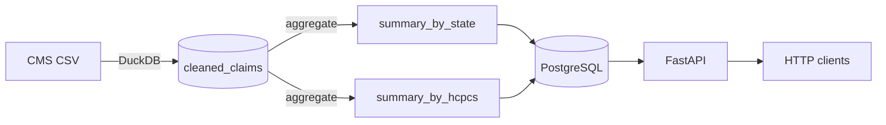

# ProviderPulse

A data pipeline and query API for Medicare provider payment records. DuckDB
processes the raw CSV into aggregated Parquet and Postgres tables, and
FastAPI serves the aggregates over HTTP. Everything runs under Docker
Compose.

## Architecture



Three services, each with its own Dockerfile and its own dependency list, so
neither image carries packages it doesn't use:

- **`postgres`** — Postgres 16, data on a named volume (`pg-medicare-data`).
- **`api`** — FastAPI, serves the pre-aggregated summary tables. Never
  touches DuckDB.
- **`pipeline`** — DuckDB, converts CSV to Parquet, loads it into Postgres,
  rebuilds the summaries. Runs once per invocation and exits; never starts
  on a plain `docker compose up`.

## Data source

[Medicare Physician & Other Practitioners by Provider and
Service](https://data.cms.gov/provider-summary-by-type-of-service/medicare-physician-other-practitioners/medicare-physician-other-practitioners-by-provider-and-service),
published by CMS. Years 2019 through 2024 are available; this project has
2023 and 2024 loaded. CMS serves the same 2024 file under two different
names (`PHY_R26_P05_V10_D24_Prov_Svc.csv` and
`Medicare_Physician_Other_Practitioners_by_Provider_and_Service_2024.csv`)
with identical row counts and columns.

## Setup

Prerequisites: Python 3.11+, Docker Desktop, Git.

```powershell
git clone <repo-url>
cd medicare-claims-pipeline
python -m venv .venv
.venv\Scripts\Activate.ps1
pip install -r requirements-dev.txt
```

Create a `.env` file in the project root (git-ignored) with:

| Variable | Purpose |
|---|---|
| `PG_HOST`, `PG_PORT`, `PG_USER`, `PG_PASSWORD`, `PG_DB` | Postgres connection |
| `DATA_ROOT`, `CLAIM_YEAR_DIR`, `CSV_FILENAME` | Where the pipeline finds the year's CSV |
| `API_PORT` | Host port for the API (optional, defaults to 8000) |

Bring up Postgres and the API:

```powershell
docker compose up --build
```

Load a year of data:

```powershell
docker compose run --rm pipeline
```

`CLAIM_YEAR_DIR` and `CSV_FILENAME` control which year loads. Loading is
delete-then-insert per year, so re-running a year is safe and a second year
appends rather than overwriting the first.

## API

Interactive docs at `http://localhost:8000/docs` once the API is running,
generated directly from the FastAPI route definitions, the authoritative
reference for exact parameters and response shapes.

Two summary endpoints, both filterable by year, plus a health check:

- `GET /claims/summary/by-state` — filterable by state
- `GET /claims/summary/by-hcpcs` — filterable by HCPCS code
- `GET /health`

Query parameters are validated server-side: year must fall in 1990-2100,
state must be two letters, HCPCS codes must be five alphanumeric characters.
Malformed input returns 422 rather than an empty result, so a caller can
tell an impossible query from one with no matching data.

## Data-quality notes

- **CMS suppresses by omission, not by blanking fields.** Records derived
  from 10 or fewer beneficiaries are excluded from the published file
  entirely, confirmed against CMS's own methodology documentation and
  directly against the 2024 CSV (zero NULLs across `Tot_Benes`, `Tot_Srvcs`,
  and `Tot_Bene_Day_Srvcs` in 9.78M rows). There's nothing left in the data
  for a per-row suppression flag to detect, which is why this project
  doesn't carry one.
- **`"XX"` is a real state code**, CMS's placeholder for unknown, foreign,
  or territory-based providers. Kept in the data rather than filtered out.
- **`total_medicare_payment` is calculated**, not a raw column:
  `Avg_Mdcr_Pymt_Amt * Tot_Srvcs`. The source file only provides per-service
  averages, not row-level totals.

## Current data

| Table | Rows |
|---|---|
| `cleaned_claims` | 19,442,320 (2023: 9,660,647 · 2024: 9,781,673) |
| `summary_by_state` | 124 (62 states × 2 years) |
| `summary_by_hcpcs` | 12,876 |

Typical pipeline timings, one year at a time, local Docker Postgres:

| Step | 2023 | 2024 |
|---|---|---|
| Load into Postgres | 7m36s | 11m25s |
| Rebuild `summary_by_state` | 4m54s | 4m03s |
| Rebuild `summary_by_hcpcs` | 4m55s | 3m45s |
| `ANALYZE` | 55s | 1m50s |

If a reload's summary rebuild steps run far outside this range, especially
in the 15-20x territory, Postgres's query planner is very likely working
from stale statistics. See CHANGELOG.md for a case where this happened.

## Testing

```powershell
pytest
mypy --strict .
```

89 tests across the pipeline and the API, in-memory DuckDB for the pipeline
tests and in-memory SQLite for the API tests, so neither suite needs a live
Postgres connection.

## Known limitations

- Kubernetes was considered and deliberately dropped. A read-only API over
  pre-aggregated tables doesn't need orchestration; Docker Compose is
  enough. Worth revisiting on a project where orchestration is the point.